<picture>
  <source media="(prefers-color-scheme: dark)" srcset="assets/banner-dark.svg">
  <source media="(prefers-color-scheme: light)" srcset="assets/banner-light.svg">
  
</picture>

<picture>
  <source media="(prefers-color-scheme: dark)" srcset="assets/typing-dark.svg">
  <source media="(prefers-color-scheme: light)" srcset="assets/typing-light.svg">
  
</picture>
<picture>
  <source media="(prefers-color-scheme: dark)" srcset="assets/divider-dark.svg">
  <source media="(prefers-color-scheme: light)" srcset="assets/divider-light.svg">
  
</picture>

<picture>
  <source media="(prefers-color-scheme: dark)" srcset="assets/hdr-about-dark.svg">
  <source media="(prefers-color-scheme: light)" srcset="assets/hdr-about-light.svg">
  
</picture>

## 我是lenyan ❄️

- 🌹你好！我是 **lenyan** 🙋‍♂️，一名热爱技术、乐于分享的程序员。
- 📖博客：[CSDN📚](https://blog.csdn.net/jgk666666)（23W+阅读）、公众号:[程序员凯凯](https://mp.weixin.qq.com/s/utI7LVBN0JyXdZyqhRA_ww)、[编程导航🌟](https://www.codefather.cn/user/1738833787455823874)（知识分享和日常记录）
- ⚔️实践项目：<a href="https://github.com/lenyanjgk/lendada" target="_blank">lendada-智慧答应用答题平台</a>  | <a href="https://github.com/lenyanjgk/len-ai-agent" target="_blank">lenAI-超级智能体</a> | <a href="https://github.com/lenyanjgk/lenrpc" target="_blank">lenRPC-轻量级框架</a> | <a href="https://github.com/lenyanjgk/cloudmusic" target="_blank">韵动轨迹-云音乐</a> |  <a href="https://github.com/lenyanjgk?tab=repositories" target="_blank">更多开源项目</a>
- 🧩算法分享：<a href="https://github.com/lenyanjgk/leetcode-solution" target="_blank">LeetCode-len解题仓库</a> | <a href="https://blog.csdn.net/jgk666666/category_12430743.html" target="_blank">CSDN：LeetCode专题</a> | <a href="https://blog.csdn.net/jgk666666/category_12435114.html" target="_blank">CSDN：蓝桥杯专题</a> | <a href="https://blog.csdn.net/jgk666666/article/details/137209476" target="_blank">lenyan-算法笔记</a>

<h3 align="left">今年汇总 ⭐</h3>

<brbrbrbr/>

<brbr/>

<picture>
  <source media="(prefers-color-scheme: dark)" srcset="assets/terminal-dark.svg">
  <source media="(prefers-color-scheme: light)" srcset="assets/terminal-light.svg">
  
</picture>

<picture>
  <source media="(prefers-color-scheme: dark)" srcset="assets/hdr-stack-dark.svg">
  <source media="(prefers-color-scheme: light)" srcset="assets/hdr-stack-light.svg">
  
</picture>

  
  
  
  
  
  
  
    
  
  

<picture>
  <source media="(prefers-color-scheme: dark)" srcset="assets/lang-dark.svg">
  <source media="(prefers-color-scheme: light)" srcset="assets/lang-light.svg">
  
</picture>

<picture>
  <source media="(prefers-color-scheme: dark)" srcset="assets/hdr-projects-dark.svg">
  <source media="(prefers-color-scheme: light)" srcset="assets/hdr-projects-light.svg">
  
</picture>

  <a href="https://github.com/lenyanjgk/len-ai-agent">
    <picture>
      <source media="(prefers-color-scheme: dark)" srcset="assets/proj-lenaiagent-dark.svg">
      <source media="(prefers-color-scheme: light)" srcset="assets/proj-lenaiagent-light.svg">
      
    </picture>
  </a>

  <a href="https://github.com/lenyanjgk/lendada">
    <picture>
      <source media="(prefers-color-scheme: dark)" srcset="assets/proj-lendada-dark.svg">
      <source media="(prefers-color-scheme: light)" srcset="assets/proj-lendada-light.svg">
      
    </picture>
  </a>

  <a href="https://github.com/lenyanjgk/lenrpc">
    <picture>
      <source media="(prefers-color-scheme: dark)" srcset="assets/proj-lenrpc-dark.svg">
      <source media="(prefers-color-scheme: light)" srcset="assets/proj-lenrpc-light.svg">
      
    </picture>
  </a>

  <a href="https://github.com/lenyanjgk/leetcode-solution">
    <picture>
      <source media="(prefers-color-scheme: dark)" srcset="assets/proj-leetcodesolution-dark.svg">
      <source media="(prefers-color-scheme: light)" srcset="assets/proj-leetcodesolution-light.svg">
      
    </picture>
  </a>

  <a href="https://github.com/lenyanjgk/zhidangtong">
    <picture>
      <source media="(prefers-color-scheme: dark)" srcset="assets/proj-zhidangtong-dark.svg">
      <source media="(prefers-color-scheme: light)" srcset="assets/proj-zhidangtong-light.svg">
      
    </picture>
  </a>

  <a href="https://github.com/lenyanjgk/cloudmusic">
    <picture>
      <source media="(prefers-color-scheme: dark)" srcset="assets/proj-cloudmusic-dark.svg">
      <source media="(prefers-color-scheme: light)" srcset="assets/proj-cloudmusic-light.svg">
      
    </picture>
  </a>

<picture>
  <source media="(prefers-color-scheme: dark)" srcset="assets/hdr-stats-dark.svg">
  <source media="(prefers-color-scheme: light)" srcset="assets/hdr-stats-light.svg">
  
</picture>
<picture>
  <source media="(prefers-color-scheme: dark)" srcset="assets/stats-dark.svg">
  <source media="(prefers-color-scheme: light)" srcset="assets/stats-light.svg">
  
</picture>
<picture>
  <source media="(prefers-color-scheme: dark)" srcset="assets/activity-dark.svg">
  <source media="(prefers-color-scheme: light)" srcset="assets/activity-light.svg">
  
</picture>

<picture>
  <source media="(prefers-color-scheme: dark)" srcset="assets/hdr-focus-dark.svg">
  <source media="(prefers-color-scheme: light)" srcset="assets/hdr-focus-light.svg">
  
</picture>
<picture>
  <source media="(prefers-color-scheme: dark)" srcset="assets/focus-dark.svg">
  <source media="(prefers-color-scheme: light)" srcset="assets/focus-light.svg">
  
</picture>

<picture>
  <source media="(prefers-color-scheme: dark)" srcset="assets/hdr-links-dark.svg">
  <source media="(prefers-color-scheme: light)" srcset="assets/hdr-links-light.svg">
  
</picture>
<picture>
  <source media="(prefers-color-scheme: dark)" srcset="assets/links-dark.svg">
  <source media="(prefers-color-scheme: light)" srcset="assets/links-light.svg">
  
</picture>

<picture>
  <source media="(prefers-color-scheme: dark)" srcset="assets/divider-dark.svg">
  <source media="(prefers-color-scheme: light)" srcset="assets/divider-light.svg">
  
</picture>

**如果哪个仓库对你有用，点个 ⭐ 就是最好的鼓励。**

